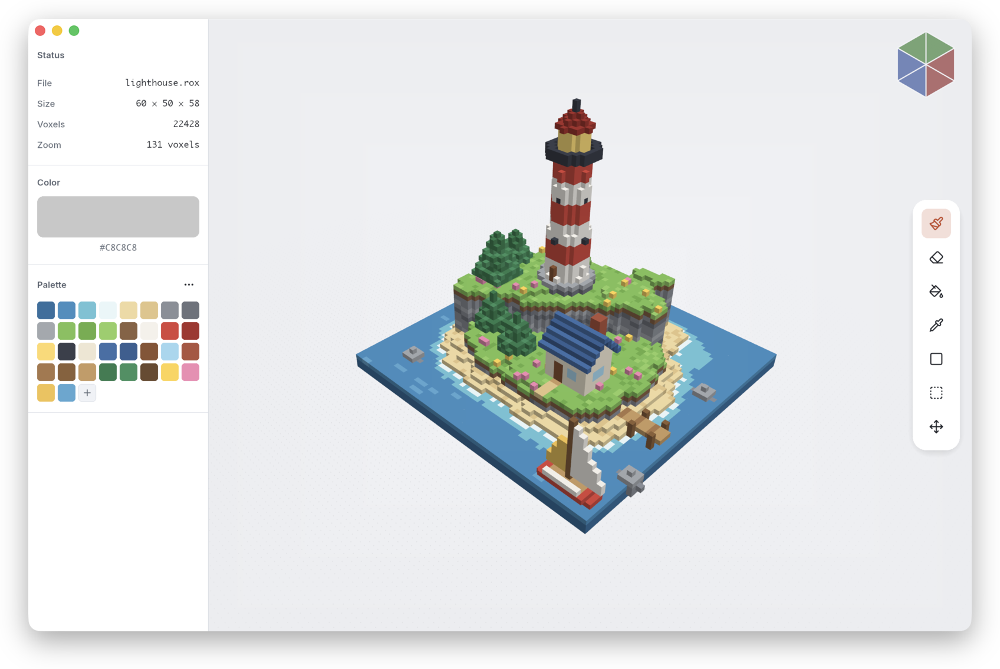
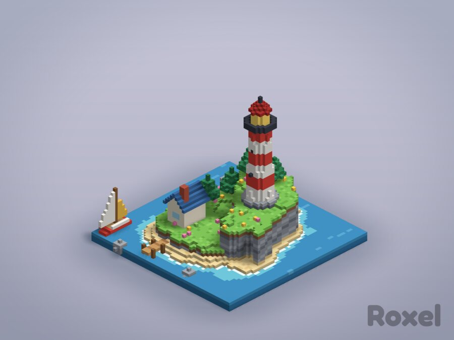
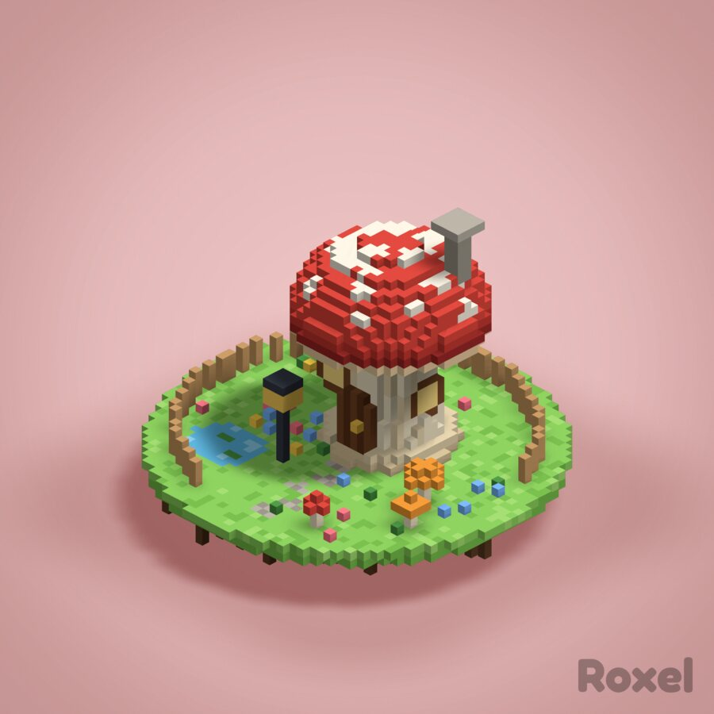
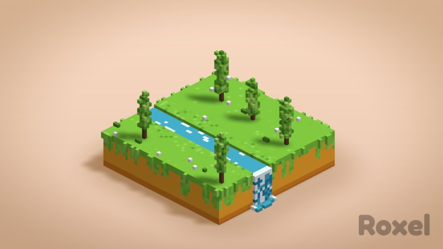
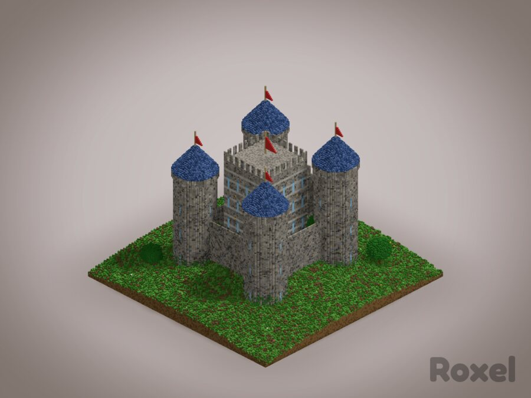
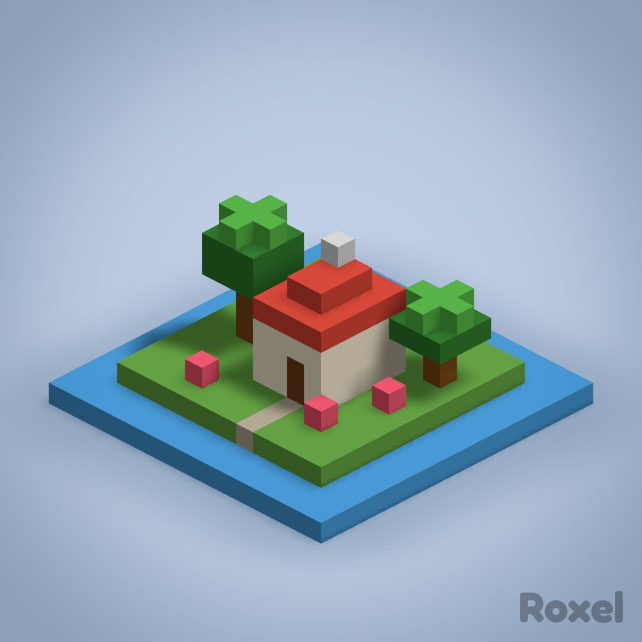
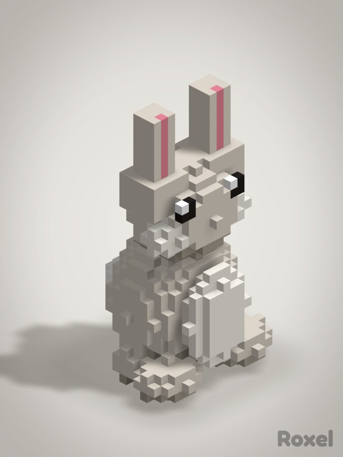

# Roxel

[](https://github.com/starzonmyarmz/roxel/actions/workflows/ci.yml)

A lightweight, open-source voxel editor for desktop. Simple to learn, fun to use, and nice to look at.

**[Read the docs](https://starzonmyarmz.github.io/roxel/)** for a walkthrough, every tool and shortcut, and the supported file formats.



## Features

- Brush, erase, recolor, eyedrop, shape, select, and move tools on an open-world 3D voxel grid — paint anywhere on X / Z and as high as memory allows; the floor at y = 0 is the only hard boundary
- Shape tool: rectangle, ellipse, line, sphere — 2D on the active build plane or extruded into a 3D box / cylinder / line / ellipsoid; press S again to cycle or long-press the shape button for a picker, hold Shift while dragging the footprint to lock aspect (square / circle / 45° line)
- Paint tool: recolor voxels by click or drag, or double-click to flood-fill a connected same-color region
- Select tool: drag a 3D AABB on a face plane or double-click a same-color region, then bulk delete / recolor / copy / cut / paste
- Move tool: drag a selected voxel along the picked face plane or arrow-key nudge; click a bare voxel with no selection to move just that voxel
- Double or halve the scene's voxel density
- Shift+click line draw between the last placed voxel and the cursor
- Built-in palettes (Sweetie 16, PICO-8, DawnBringer 16/32, Endesga 32, NA16, Basic) plus user palettes with add/new/duplicate/rename/delete and drag-to-reorder
- Orbit / pan / zoom camera with isometric default angle
- Save / load compact `.rox` project files, with a 10-entry Open Recent menu
- Import MagicaVoxel `.vox`, Qubicle `.qb`, and Goxel `.gox`
- Export to MagicaVoxel `.vox`, Goxel `.gox`, Wavefront `.obj`, glTF `.glb` (Unity / Godot ready), transparent `.png`, and `.svg`, plus a lit, framed Roxel Shot PNG for sharing
- Import / export Adobe Swatch Exchange `.ase` palettes
- `rox` command-line tool: print a model's bounds and colors as JSON, render it to an isometric PNG, convert it to another format, or build one from a list of ops, without opening the app
- In-app toast notifications for save / load / import / export results
- Light / Dark / System themes with a custom canvas color, plus a floor dot grid and an RGB axis triad at the world origin, each toggled from the View menu
- Color readouts and inputs in Hex, RGB, HSL, HSB or OKLCH
- Canvas-first UI: a single left inspector with floating tool island and (on Win/Linux) a top-center menu pill, all hideable for focus mode

## Roxel Shots

**File → Export → Roxel Shot (PNG)…** turns a model into a lit, framed image for sharing. These were all made with it:

<p>
  
  
  
  
  
  
</p>

## Install

Prebuilt downloads for macOS (a universal `Roxel.app`), Windows (an installer, or a plain `Roxel.exe`) and Linux (a tarball with an install script) are attached to each [GitHub Release](https://github.com/starzonmyarmz/roxel/releases), along with the `rox` command-line tool for each platform and a `SHA256SUMS` file. They're also published to [itch.io](https://starzonmyarmz.itch.io/roxel), where the [itch app](https://itch.io/app) keeps them up to date. See [Installation](https://starzonmyarmz.github.io/roxel/installation.html) for each platform's steps.

With [Homebrew](https://brew.sh), install the app (macOS) and the `rox` command-line tool (macOS and Linux x86_64):

```sh
brew install --cask starzonmyarmz/tap/roxel
brew install starzonmyarmz/tap/rox
```

> [!WARNING]
> **macOS builds are self-signed and not notarized.** Gatekeeper will block first launch — either as "unidentified developer" or, on recent macOS versions, as "damaged and can't be opened" (the quarantine attribute set on downloaded files). To bypass:
>
> 1. Right-click `Roxel.app` → **Open** → confirm in the dialog.
> 2. If macOS still refuses with the "damaged" message, strip the quarantine attribute:
>
>    ```sh
>    xattr -dr com.apple.quarantine /Applications/Roxel.app
>    ```
>
> Windows builds are unsigned; SmartScreen will warn on first run — click **More info** → **Run anyway**.

Roxel checks GitHub for a new release on launch, at most once a day. The request carries only the Roxel version in its `User-Agent`. Turn it off under **Preferences → Updates**; see [Preferences](https://starzonmyarmz.github.io/roxel/preferences.html#updates) for details.

## Run

```sh
cargo run --release
```

The dev profile (`cargo run`) builds Roxel at `opt-level = 1` and leaves dependencies unoptimized. `cargo run --features dev` links Bevy dynamically for faster rebuilds.

## Controls

Left mouse drag in the viewport applies the current tool. Right mouse drag orbits the camera. Scroll to zoom. `Cmd/Ctrl + K` opens the command palette, which lists every command with its shortcut.

| Key                         | Action                                               |
| --------------------------- | ---------------------------------------------------- |
| `B` `E` `P` `I` `S` `M` `V` | Brush, Erase, Paint, Eyedropper, Shape, Select, Move |
| `Alt` (hold)                | Temporary eyedropper                                 |
| `Space` + left-drag         | Pan                                                  |
| `Cmd/Ctrl + 0`              | Frame view on the model                              |
| `Cmd/Ctrl + Z`              | Undo (`Cmd/Ctrl + Shift + Z` to redo)                |

See [Keyboard Shortcuts](https://starzonmyarmz.github.io/roxel/keyboard-shortcuts.html) for the full list.

## Packaging a macOS .app

```sh
cargo install cargo-bundle
cargo bundle --release
open target/release/bundle/osx/Roxel.app
```

The bundle picks up `assets/icons/roxel.icns` via `[package.metadata.bundle]` in `Cargo.toml`.

## Releases

Tagged versions trigger a GitHub Actions workflow that builds a universal
`Roxel.app` (macOS), `Roxel.exe` plus an Inno Setup installer
(`packaging/windows/roxel.iss`) for Windows, and a Linux tarball
(`packaging/linux/`), plus a `rox` CLI archive for each platform. It
uploads them to a GitHub Release with a `SHA256SUMS` file, then pushes the macOS, Windows and Linux builds to the
matching itch.io channels (the app only, not `rox`) with
[butler](https://itch.io/docs/butler/). The push needs a `BUTLER_API_KEY`
repository secret (from `butler login`, or an itch.io API key).

To cut a release, run `scripts/release` on an up-to-date `main`
(`--dry-run` previews it). Commits since the last tag decide the bump:

| Commits since the last tag | Bump |
|---|---|
| any `!` or `BREAKING CHANGE:` footer | major |
| any `feat` | minor |
| any `fix`, `perf` or `revert` | patch |
| only other types | no release |

Pass `patch`, `minor`, `major` or an exact version to override it. The
script writes the version to `[workspace.package]` in `Cargo.toml`, turns
`[Unreleased]` in `CHANGELOG.md` into the new version's section, commits
`chore(Release): X.Y.Z`, tags `vX.Y.Z` and pushes. Only the tag push
releases anything, and the workflow fails if the tag doesn't match
`Cargo.toml`. The release notes are that version's changelog section.

The workflow lives at `.github/workflows/release.yml`. It needs the
`BUTLER_API_KEY` secret. The Homebrew formula and cask in
`packaging/homebrew/` are picked up by
[starzonmyarmz/homebrew-tap](https://github.com/starzonmyarmz/homebrew-tap),
which renders them from each new release. See [Install](#install) for first-run bypass on unsigned macOS / Windows builds and the Linux install steps.

## File format

`.rox` is a versioned binary format (little-endian). Open-world: only
occupied chunks are stored, there's no fixed grid size, and coordinates are
signed, so models can sit anywhere relative to the origin.

```text
"ROXL"  u16 format version
section* = [u8; 4] tag, u32 length, payload
  VOXL  u32 decompressed length + zstd frame: chunk edge, sorted RGBA color
        table, then each 32³ chunk (sorted) as sparse or dense color indices
  PALT  optional active palette (name + RGBA colors)
  PREV  optional PNG preview
```

Readers skip unknown sections, so optional data can be added without a
version bump. The full layout is documented in
`roxel-core/src/io/project.rs`. Files from before 0.9 (pretty-printed RON with
a `voxels` list) still open.

## License

MIT — see [LICENSE](LICENSE).
