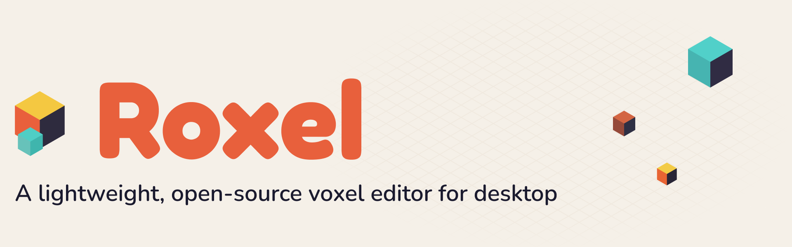
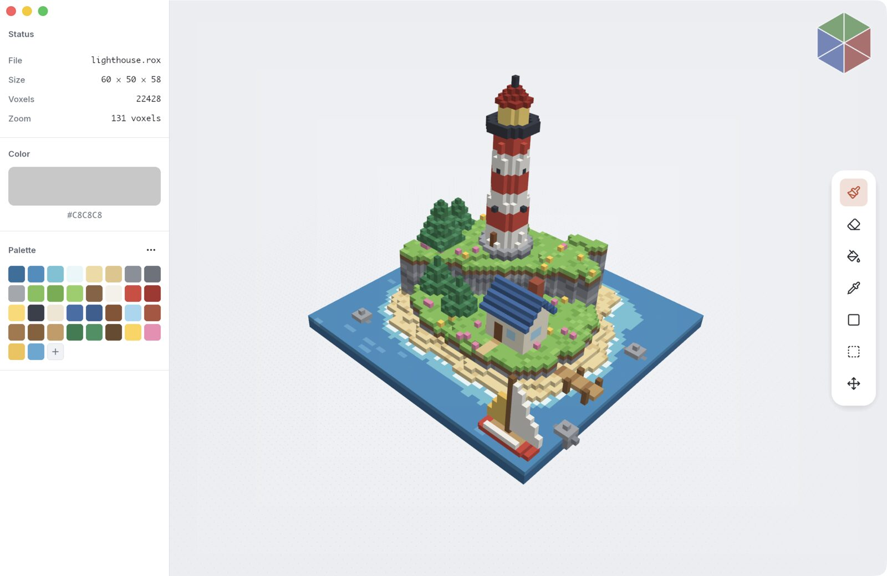

# 

Made for hobbyists and indie creators. Simple to learn, fun to use, and nice to look at.

[Download on itch.io](https://starzonmyarmz.itch.io/roxel) [Source on GitHub](https://github.com/starzonmyarmz/roxel)

MIT licensed: free to use, fork, and build on.

## What is Roxel?

Roxel is a desktop voxel editor for building 3D models out of cubes. You paint on an open-world grid — place voxels anywhere on the horizontal plane and as high as memory allows. The floor at `y = 0` is the only hard boundary.

Roxel reads and writes the common voxel formats (MagicaVoxel, Qubicle, Goxel) and exports to game-engine and image formats (glTF, OBJ, PNG, SVG), so it fits alongside the tools you already use.

## Features

- **[Tools](tools.md)** Brush, erase, paint, eyedrop, shape, select, and move. Shapes come in 2D and extruded 3D, spheres included.
- **[Palettes](palettes.md)** Sweetie 16, PICO-8, DawnBringer, Endesga 32 and more built in, plus your own palettes and `.ase` import / export.
- **[Import & Export](import-export.md)** `.rox` projects, MagicaVoxel `.vox`, Qubicle `.qb`, Goxel `.gox`, glTF, OBJ, PNG and SVG.
- **[Everything else](preferences.md)** An open-world grid, Light / Dark / System themes, a floor dot grid, an RGB axis triad, and a hideable, canvas-first UI.

## Where to go next

- New here? Start with [Installation](installation.md), then [Getting Started](getting-started.md).
- Want the full tool reference? See [Tools](tools.md) and [Keyboard Shortcuts](keyboard-shortcuts.md).
- Moving files in or out? See [Import & Export](import-export.md).
