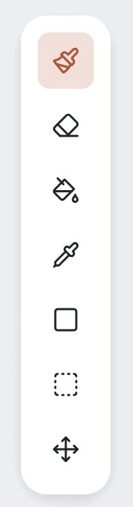

# Tools

Roxel has seven tools, reachable from the floating tool island or by keyboard. Left-mouse drag in the viewport applies the current tool.

## Brush — `B`

Places voxels in the active color. Drag to paint a stroke. Paints onto the face of existing voxels or onto the build plane in empty space.

## Erase — `E`

Removes voxels under the cursor. Drag to erase a stroke. With a selection active, clicking a selected voxel clears the whole selection.

## Paint (recolor) — `P`

Recolors existing voxels in place without adding or removing geometry.

- **Click or drag** to recolor each voxel you touch.
- **Double-click** a voxel to flood-fill it: every connected voxel of the same color takes the active color.
- With a selection active, clicking a selected voxel recolors the whole selection; clicks elsewhere recolor as usual. `F` fills the selection from the keyboard.

## Eyedropper — `I`

Samples the color of the voxel under the cursor and makes it active. Holding **`Alt`** anytime acts as a temporary eyedropper — release to snap back to your previous tool.

## Shape — `S`

Draws rectangles, ellipses, lines and spheres. Press `S` again while the Shape tool is active to cycle through them, or **long-press** the shape button on the tool island to open the picker.

1. Drag on a face or the floor to draw the footprint, then release.
2. Move the mouse along the face's normal to extrude, then click to commit. Click without moving for a flat, one-voxel-thick shape.

- **Rectangle**, **ellipse** and **line** extrude into a box, a cylinder or a thick line.
- **Sphere** uses the footprint for two of its axes and the extrude distance for the third. A square footprint (hold `Shift`) extruded to the same depth makes a round sphere; anything else makes an ellipsoid.
- **Hold `Shift`** while dragging the footprint to lock aspect — square, circle, or 45° line.
- `Esc` or a right-click cancels the shape in progress.

## Select — `M`

Drag a 3D axis-aligned box on a face plane to select a region, or **double-click** a voxel to select every connected voxel of the same color. `Cmd/Ctrl + A` selects everything; `Cmd/Ctrl + D` or `Esc` clears the selection. Once selected, you can:

- Bulk **delete** the voxels inside (`Backspace` / `Delete`).
- Bulk **recolor** them (`F`, or click with the Paint tool).
- **Copy**, **cut** and **paste** them (see below).
- Hand the selection to the Move tool.

## Move — `V`

Moves voxels along the picked face plane, or nudge with the arrow keys.

- With a selection active, Move operates on the whole selection.
- Click a bare voxel with **no** selection to move just that single voxel.
- Arrow keys nudge one voxel on X / Z; `Shift` + `↑`/`↓` nudges on Y.
- Hold `Shift` while dragging to lock the move to the same horizontal plane.
- `Esc` or a right-click during a drag puts the voxels back.

## Copy & paste

`Cmd/Ctrl + C` copies the selected voxels and `Cmd/Ctrl + X` cuts them. `Cmd/Ctrl + V` pastes onto the face under the cursor, the way the Brush places a voxel. With the pointer away from the canvas (for example when you paste from the command palette or menu pill), the copy lands at the selection, or where it was copied from. A paste that would put any voxel below the floor is refused. Each paste is one undo step.

## Density

**Edit → Double Density** splits every voxel into a 2×2×2 block of the same color, so you can add finer detail. **Edit → Halve Density** merges each 2×2×2 block into one voxel of its most common color; when a block had more than one color, the notification says detail was merged. Both are one undo step.

See [Keyboard Shortcuts](keyboard-shortcuts.md) for the full key reference.
